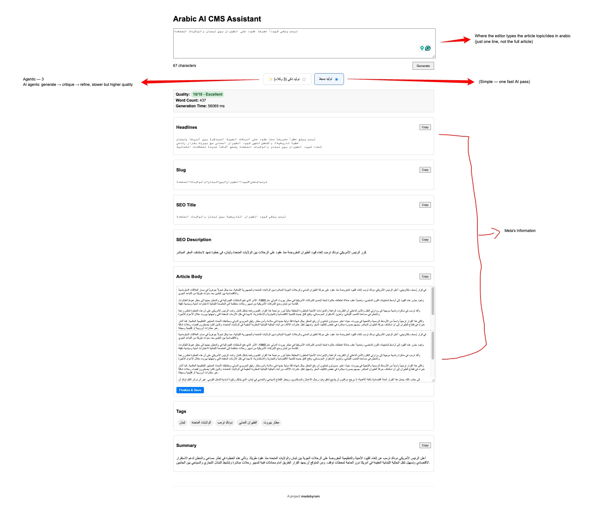

# Governed AI CMS

**AI-powered Arabic CMS Assistant with Governance, Evaluation, and Human-in-the-Loop Override Metrics**

This repository contains a production-style Arabic CMS prototype that goes beyond simple content generation. It demonstrates rigorous architectural control over generative AI outputs with:

- deterministic validation
- structured JSON enforcement
- hybrid evaluation (rule-based + AI critique)
- a 3-agent agentic refinement loop (Generator → Critic → Refiner → Critic again)
- asynchronous critique pipelines
- human override tracking
- audit-ready lifecycle analysis

This is not a toy — it’s a governed, observable AI system.



---

## 📌 Motivation

Traditional editorial workflows are manual and slow.  
Basic AI integrations generate content, but lack:

- output validation
- production guardrails
- observability
- trust and override measurement

**Governed AI CMS** solves these by layering AI generation with deterministic checks and human feedback loops.

---

## 🧠 Key Concepts

**Deterministic Guardrails**
- JSON response enforcement
- Word-count enforcement with retry
- Slug normalization
- Tag deduplication

**Hybrid Evaluation**
- Deterministic rule-based scoring
- AI Critique (async, background in simple mode; synchronous, run twice, in agentic mode)
- Combined confidence metrics

**Agentic Refinement Loop**
- Generator → Critic → Refiner → Critic (re-scored)
- Both drafts and both scores shown to the editor side by side

**Human-in-the-Loop Governance**
- Editor edits tracked
- Word-level override diff
- Override percentage computed

**Audit and Observability**
- `/api/audit/:id` exposes lifecycle state
- Critique and overrides stored in SQLite
- Metrics available for dashboards or dashboards

---

## 🚀 Architecture

The UI offers two generation modes, توليد بسيط (Simple) and توليد ذكي (Agentic):

```text
Simple mode:
Editor UI → Express API → Structured Generation → Deterministic Validation
→ Deterministic Scoring → Async AI Critique → Database
→ Finalization w/ Override Tracking → Database

Agentic mode (3-agent loop):
Editor UI → Express API → Generator (draft v1) → Critic (score v1)
→ Refiner (draft v2, addressing critic notes) → Critic (re-run, score v2)
→ Database → Editor picks v1 or v2 → Finalization w/ Override Tracking
```

Layers include:

1. **Frontend (UI)**  
   Accepts topic, shows structured output, supports edits/finalize.

2. **Backend API (Node + Express)**  
   Endpoints:
   - `POST /api/generate`
   - `GET /api/generate/audit/:id`
   - `POST /api/generate/finalize/:id`
   - `POST /api/generate-agentic`
   - `GET /api/generation/:id`
   - `POST /api/finalize/:id`

3. **Model Layer**  
   Calls Gemini 3.8 Flash with `response_mime_type: "application/json"`.

4. **Post-Processing Guardrails**  
   Ensures schema compliance and safe outputs.

5. **Evaluation Pipeline**  
   Deterministic scoring + async AI critique.

6. **Persistence (SQLite)**  
   Stores:
   - original output
   - final editor output
   - override diff + percentage
   - critique JSON + status

---

## 🛠 Features

### ⚡ Fast Draft Generation
Returns structured content quickly with validation in place.

### 🧮 Hybrid Scoring
Captures rule-based and model-based quality assessment.

### 🗂 Async Critique
Background critique runs post-generation and is stored with lifecycle tracking (`PENDING → COMPLETE`).

### ✍️ Editor Override Tracking
Editors can refine the article body.  
The backend calculates:

```text
override % = (changed words / total words) × 100
```

Capturing editorial friction.

### 🤖 Agentic Mode (3-Agent Loop)
Toggle "توليد ذكي (3 وكلاء)" in the UI to run `POST /api/generate-agentic` instead of the simple path:

1. **Generator** writes draft v1 from the topic.
2. **Critic** scores v1 (1–10) with per-field feedback (headlines, body, SEO, tags, language) and a suggested-improvements list.
3. **Refiner** rewrites the draft into v2, explicitly addressing each critic note, and writes its own `changes_summary`.
4. **Critic runs again** against v2, so the "improved version" is backed by an actual score instead of just styling.

The UI shows both drafts side by side with both scores, per-stage timings (`generation_ms`, `critique_ms`, `refinement_ms`, `critique_v2_ms`, `total_ms`), and the editor — not the system — picks which version to finalize via `POST /api/finalize/:id`.

### 🔍 Audit Endpoints
Inspect completed critiques:

```http
GET /api/audit/:id
```

Return:

```json
{
  "generationId": 1,
  "critiqueStatus": "COMPLETE",
  "critique": {
    "score": 7,
    "critique": "..."
  }
}
```

---

## 📦 Setup

Clone repo:
```bash
git clone https://github.com/ramdev9/governed-ai-cms.git
cd governed-ai-cms
```

Install dependencies:
```bash
npm install
```

Create `.env`:
```text
GEMINI_API_KEY=your_api_key_here
PORT=5001
HF_TOKEN=hf_your_token_here
JAIS_MODEL=inceptionai/jais-family-13b-chat
```

`AGENT_PROVIDER=gemini` runs the three-agent loop (Generator, Critic, Refiner) on Gemini 3.8 Flash, using `GEMINI_API_KEY`. Set `AGENT_PROVIDER=jais` to use Jais instead.

`HF_TOKEN` is a Hugging Face read token for the Jais path. Jais chat weights are not on Hugging Face’s free serverless router. Point `HF_API_URL` at a dedicated Inference Endpoint when you have one. The public `api-inference.huggingface.co` host no longer resolves.

Run server:
```bash
node server/index.js
```

Open in browser:
```text
http://localhost:5001
```

---

## 📊 Development Notes

**Response Schema Enforcement**
Uses Gemini’s `response_mime_type: "application/json"` flag for deterministic output.

**Retry Logic**
If model output fails schema filters, the system retries once.

**Async Critique**
Critique is fire-and-forget — non-blocking for users.

**Override Tracking**
Word-level diff uses the `diff` npm package.

---

## 🧠 Why This Architecture Matters

This system demonstrates how to control, evaluate, and govern generative AI output in a real production-like context.
It documents tradeoffs such as:
- Latency vs critique depth
- Deterministic vs probabilistic behavior
- Human trust metrics vs model confidence

It is designed to be observable and auditable.

---

## 📚 Docs

- [PRD — 2026 AI-Era Template](docs/12_PRD_2026_AI_Era_Template.md) ([PDF](docs/PRD_Governed_AI_CMS.pdf))
- [Original MVP PRD](docs/01_Product_Requirements.md)
- [Architecture Diagram](docs/Architecture_Diagram.png) — source of truth: [Figma board](https://www.figma.com/board/vUqbsYK5oW3Lausxxj3ZCi/Arabic-AI-CMS-Architecture)
- [AI Evaluation Plan](docs/06_AI_Evaluation_Plan.md) — see also the runnable eval set at [`server/evals/`](server/evals/)
- Full doc set: [`docs/`](docs/)

---

## 📍 Future Improvements

- Section-level regeneration
- Event-driven evaluation queue
- Admin dashboard for metrics
- Role-based access controls
- Semantic tag validation

---

## 📄 License
MIT License
